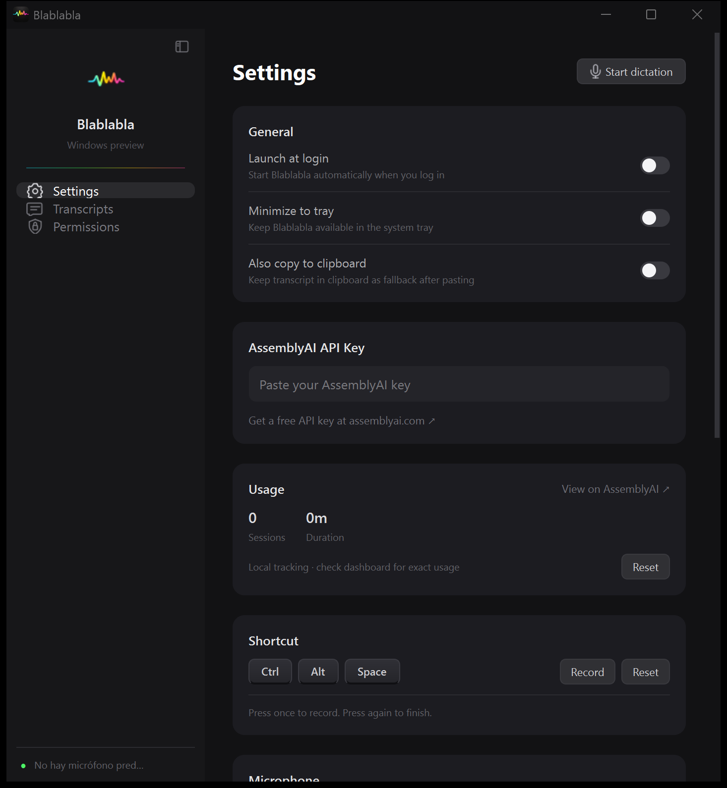

# Blablabla para Windows 11

Cliente nativo Qt de escritorio, con la identidad del cliente Swift/macOS:
barra lateral plegable, logo original y paleta oscura con acentos cian, verde,
amarillo y rosa. La versión 0.5.0 amplía la tipografía, las áreas de pulsación y
la separación entre contenidos en **Settings**, **Transcripts** y **Permissions**.
La 0.5.1 mantiene esos controles y su distribución, con acabado carbón, superficies
en capas, onda de marca en la cabecera y tamaño inicial de 840 × 740. El hover,
las transiciones y el nivel de voz tienen una respuesta breve; la rueda se desplaza
suavemente y el panel táctil conserva el comportamiento de Qt. Las animaciones
decorativas respetan la preferencia de Windows y no hay animación continua en reposo.
La 0.6.0 cambia la composición a navegación superior y control de voz inferior,
liberando ancho para el contenido. Añade ocho tonos cortos propios, botones **Play**
visibles y protege todos los selectores cerrados frente a cambios accidentales con
la rueda: el gesto desplaza la página. La selección con teclado y la lista abierta
mantienen su funcionamiento. La barra de voz se comprueba en todos sus estados a
700 × 600, incluido un atajo largo y el cronómetro.
La 0.7.0 añade **Compact mode**, junto a **Start dictation**: la ventana completa
se oculta y queda un panel flotante de 320 × 112 con la onda, estado, tiempo,
inicio/parada y texto en directo. Puede arrastrarse; recuerda el modo y la posición
al reiniciar. El botón de ampliar vuelve a la interfaz completa. Comparte la sesión
de dictado y el atajo, y sustituye el indicador pequeño mientras está activo.
La 0.7.1 dibuja onda y texto dentro de la misma superficie del compacto para evitar
los bloques de repintado durante la escucha. El texto de **Ctrl + Alt + Espacio**
permanece dentro del panel. El botón **Minimize to taskbar** lo minimiza en la barra
de tareas central, incluso con **Minimize to tray** activado para la ventana completa;
al pulsar su icono vuelve el mismo compacto. El dictado no restaura por su cuenta
una ventana que se haya minimizado. El panel sigue siendo arrastrable.
En la 0.7.2, minimizar el compacto deja disponible la onda flotante pequeña, con
estado y texto de escucha al usar el atajo. Respeta **Show only when recording** y
**Show live text**. Recuperar el compacto oculta de nuevo el indicador y la burbuja
externos; el dictado no abre por sí solo la ventana minimizada.
La rama de trabajo es `feat/windows-local`; el código original de macOS permanece
en `Sources/`. No requiere Xcode, Electron ni un servidor local.



## Ejecutar

Si ya se ha generado el ejecutable, abre **`Windows/dist/Blablabla.exe`**.
Es un ejecutable local sin instalador ni firma digital; no se publica como una
release oficial. Incluye Python y las dependencias.

Para ejecutar desde código fuente:

1. Instala [Python 3.11 o superior](https://www.python.org/downloads/windows/),
   marcando **Add Python to PATH**. En este equipo ya está instalado.
2. Haz doble clic en **`Windows/run.cmd`**. Crea un entorno aislado en `Windows/.venv`
   e instala las dependencias. La primera ejecución necesita Internet.
3. En **Settings**, introduce tu [clave API de AssemblyAI](https://www.assemblyai.com/dashboard/signup).
   Los ajustes se guardan automáticamente. **Done** oculta la clave después de editarla.
   Puedes seleccionar un micrófono en **Microphone** o usar **System Default**.
4. En Windows, permite el micrófono para aplicaciones de escritorio en
   **Configuración → Privacidad y seguridad → Micrófono**.
5. Pon el cursor en un campo de texto de otra aplicación. Pulsa
   **Ctrl + Alt + Espacio**, espera al estado **Escuchando**, habla y pulsa
   el mismo atajo para detener. El texto se inserta cuando termina la transcripción.

También puedes usar **Start dictation / Stop dictation** en la ventana o hacer
clic en la pequeña onda flotante sobre la barra de tareas.
**Compact mode** mantiene los controles y las últimas palabras en una mini ventana
siempre visible, sin activar otra ventana al comenzar el dictado. **Expand Blablabla**
recupera la interfaz completa; el texto y la sesión se conservan al cambiar de modo.
El botón utiliza como destino la última ventana externa que tuvo el foco mientras
Blablabla estaba abierta. Si no hay destino, conserva el texto para copiarlo.

```powershell
# Alternativa al doble clic, desde la raíz del repositorio
powershell -NoProfile -ExecutionPolicy Bypass -File .\Windows\run.ps1
```

### Abrir desde el escritorio o el menú Inicio

Después de generar el EXE, puedes abrirlo directamente con CAS cerrado.
Para crear un acceso, haz clic derecho sobre `Windows/dist/Blablabla.exe`,
elige **Mostrar más opciones → Enviar a → Escritorio (crear acceso directo)**
y renómbralo **Blablabla**. El acceso debe apuntar al EXE, sin argumentos.

Para encontrarlo desde Inicio, copia ese acceso a la carpeta que abre
**Win + R → `shell:programs`**. También puedes anclarlo a la barra de tareas
desde su icono mientras está abierto. Conserva el EXE en la ubicación a la que
apunta el acceso; puedes copiarlo antes a una carpeta permanente de tu usuario.

## Qué incluye

- Barra de dictado permanente en todas las páginas, con nivel de entrada,
  tiempo transcurrido y estados de captura, conexión y finalización.
- Botones **Copy text** de al menos 118 × 42 píxeles lógicos, siempre visibles
  en la cabecera de cada transcripción. Confirman **Copied** durante 1,8 s;
  el texto en directo también se puede copiar cuando está disponible.
- Ajustes de clave, micrófono, atajo y entrega al principio; foco de teclado visible,
  contraste reforzado y disposición comprobada desde ventanas de 700 × 600.

- Grabación de micrófono mono PCM de 16 bits, a la frecuencia nativa del dispositivo.
- Transcripción en directo mediante AssemblyAI Universal Streaming v3,
  modelo `universal-3-6-pro`, con idiomas detectados automáticamente.
- Atajo global configurable en **Shortcut → Record**, incluso con la ventana minimizada.
  Toque corto: empieza y otro toque termina. Mantenerlo pulsado: graba mientras lo
  mantienes y pega al soltarlo. La grabación empieza al instante mientras conecta.
- Pegado instantáneo con un único Ctrl+V; el portapapeles anterior se restaura a los 1,5 s.
  Una copia manual o un cambio desde otra aplicación cancela esa restauración.
  Los pegados consecutivos conservan el contenido original, incluido su formato HTML.
- Modos **Clipboard only**, **Also copy to clipboard** y copia manual de transcripciones.
- Historial local y clave cifrada con Windows DPAPI para el usuario actual.
- Recuperación de texto parcial en el historial cuando falla la conexión.
- Parar durante la conexión detiene la captura en la siguiente llamada del dispositivo
  y entrega únicamente el audio anterior a la parada. El uso local contabiliza los
  fotogramas capturados, sin sumar la espera de red al tiempo de grabación.
- Indicador flotante con la onda y el gradiente originales, animado a 60 fps con el nivel
  del micrófono, y texto en vivo junto al indicador (**Show live text**).
- Fondo Mica de Windows 11 (tema opaco en versiones anteriores) y animaciones suaves.
- Bandeja del sistema con punto de estado (rosa grabando, cian conectando o finalizando),
  avisos de error como notificación de Windows, inicio al iniciar sesión opcional,
  sonidos de Windows y uso local.
- Historial por tarjetas, búsqueda y paginación como en macOS.

El audio va directamente a AssemblyAI y requiere Internet y una cuenta con acceso
al servicio. No es transcripción offline: «local» se refiere a ejecutar la aplicación
en tu PC. No guarda archivos de audio ni incorpora telemetría.

Los datos se guardan en `%LOCALAPPDATA%\Blablabla\windows.json`.
La clave está cifrada; los textos del historial no. No añadas este archivo al repositorio.

## Límites de esta primera versión

- El atajo no admite doble toque ni tecla Fn.
- Cerrar la ventana termina la aplicación y cierra la sesión activa. Minimizarla
  mantiene disponible el atajo. Si activas **Minimize to tray**, cerrar o minimizar
  oculta la ventana y el dictado sigue disponible desde la bandeja; **Quit Blablabla**
  cierra la app. Cada grabación dura como máximo nueve minutos.
- Si cambias a una ventana distinta mientras dicta, no roba su foco: guarda el
  resultado en el historial. Si vuelves a la ventana de Blablabla, puede restaurar
  el foco del destino original.
- Windows bloquea la inserción en apps ejecutadas con privilegios superiores.
  Usa copia manual en esos casos. Las apps que no acepten Ctrl+V para pegar no
  recibirán el texto; el historial lo conserva para copiarlo a mano.
- Si otra aplicación usa tu atajo, puedes usar el botón o grabar otra combinación.
- La lista de micrófonos se actualiza con **Microphone → Refresh**. Si desenchufas
  el micrófono durante una sesión, revisa el texto parcial y vuelve a empezar.
- Los permisos, sonidos y barra de título son los de Windows; no se imitan permisos
  exclusivos de macOS. **Updates** busca en GitHub Releases una versión más nueva con
  un archivo `Blablabla-vX.Y.Z-Windows.zip` y ofrece descargarla; no se instala sola
  porque el ejecutable no está firmado. `build.ps1` genera ese zip en `Windows/build/`
  (sube `APP_VERSION` en `app.py` antes de publicar).
- **Launch at login** modifica únicamente el valor `Blablabla` en la clave de inicio
  del usuario actual de Windows. Está desactivado por defecto y se elimina al desactivarlo.

## Generar un ejecutable

```powershell
powershell -NoProfile -ExecutionPolicy Bypass -File .\Windows\build.ps1
```

Genera `Windows/dist/Blablabla.exe` con PyInstaller. El entorno, los archivos de
compilación y el ejecutable están excluidos de Git. Se genera como carpeta (EXE +
`_internal`) para que arranque al instante; para llevarlo a otro Windows 11 de 64
bits copia la carpeta `dist` entera, sin necesidad de instalar Python.

## Verificación

Para cambios de interfaz locales, usa primero las comprobaciones focalizadas
**headless**, sin ventanas, reproducción real ni registro/envío de atajos al escritorio:

```powershell
.\Windows\.venv\Scripts\python.exe .\Windows\check_ui_headless.py
```

Ejecuta cinco casos afectados (navegación, rueda, Play, estados de voz y archivos
de audio). Se puede pasar el nombre de uno de los casos definidos en `CHECKS` para
comprobar solo ese comportamiento. No ejecuta la suite completa.

Los ocho tonos incluidos se regeneran con `Windows/generate_sounds.py`, usando solo
la biblioteca estándar. Para actualizar la app sin abrir una ventana ni quitar foco,
puede iniciarse con `Blablabla.exe --background`; se abre desde la bandeja.

La suite completa de integración con el escritorio es opcional y **abre ventanas
y envía teclas reales**. Ejecútala solo cuando se quiera comprobar expresamente
esa integración:

Cierra otras instancias de Blablabla antes de ejecutar las pruebas, para que el
atajo global esté libre. La instalación de Python para pruebas debe incluir
Tcl/Tk: se usa un campo de texto real para comprobar la inserción Unicode.

```powershell
.\Windows\.venv\Scripts\python.exe -m unittest discover -s Windows -p test_windows.py -v
```

Las pruebas verifican cierre de sesión y conservación de finales tardíos,
reemplazo de turnos formateados, errores y cancelación durante la conexión,
cifrado DPAPI, registro del atajo, inserción Unicode real en un campo de texto,
persistencia del historial, navegación Qt, búsqueda/copia, clave enmascarada, atajo
real recibido por Qt, indicador, inicio al login simulado y reapertura desde bandeja.
La prueba de inserción abre
brevemente una ventana de prueba. No usan una clave API real ni envían audio a la nube.

La validación completa de dictado requiere probar con tu micrófono y una clave API:
una frase corta en español, varias frases con pausas, copiar desde el historial,
dictado en otra aplicación con la ventana minimizada y parada/cierre durante una sesión.

En este equipo (Windows 11 Pro, 10/10/2026) se ha generado el EXE y comprobado
su arranque. La interfaz usa Qt y se comprueba mediante capturas renderizadas.
El rediseño 0.5.0 añade pruebas de copia visible y confirmación, ventanas compactas
con texto largo, protección del portapapeles y parada durante la conexión.
Windows no tiene micrófono predeterminado y
el endpoint Realtek de micrófono anunciado por el controlador no entrega buffers
de audio. Hay que conectar/habilitar una entrada funcional y seleccionarla.
La aplicación comprueba que recibe audio antes de abrir la sesión de AssemblyAI.
El dictado cloud sigue pendiente de prueba con micrófono y clave API reales.

Verificación del rediseño (30/10/2026): pasan las **33 pruebas** de protocolo,
interfaz Qt y Windows, incluida inserción Unicode real y recepción del atajo global.
Se han revisado capturas de historial, ajustes, permisos, copia confirmada y dictado
simulado a 1020 × 820 y 700 × 600, con datos ficticios. Se genera el ejecutable
local 0.5.0; las pruebas no consumen crédito de AssemblyAI. El dictado con voz real
requiere un micrófono funcional seleccionado y una comprobación manual adicional.

Revisión visual 0.5.1 (30/10/2026): **35 pruebas** satisfactorias. Incluyen inversión
del desplazamiento con rueda, interrupción por teclado, ruta de panel táctil y
respuesta inmediata al desactivar animaciones. Capturas revisadas a 840 × 740 y
700 × 600; el contenido y la distribución de ajustes e historial se conservan.

Referencias: [protocolo AssemblyAI](https://www.assemblyai.com/docs/streaming/message-sequence),
[API y modelos](https://www.assemblyai.com/docs/streaming/api-spec/streaming-websocket),
[captura de audio](https://python-sounddevice.readthedocs.io/en/latest/api/raw-streams.html),
[inserción de Windows](https://learn.microsoft.com/en-us/windows/win32/api/winuser/nf-winuser-sendinput).
