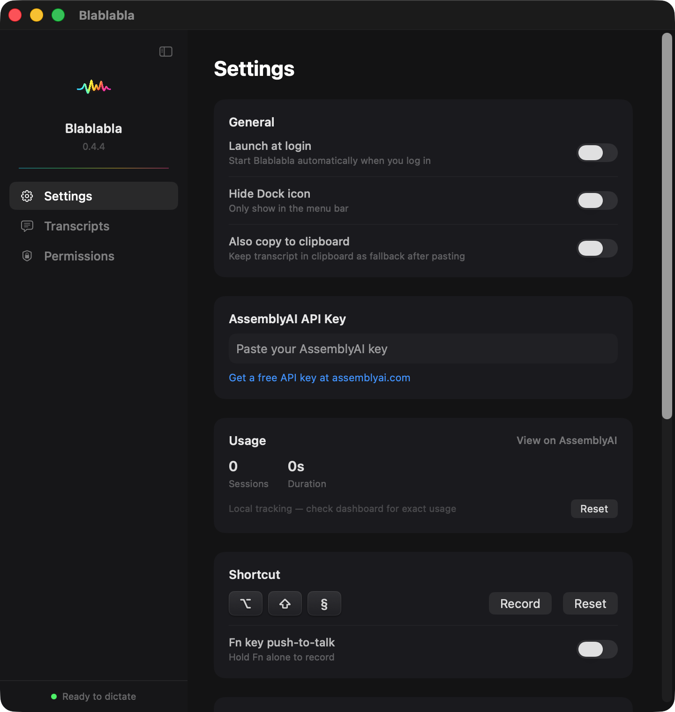

# Streaming session cleanup validation

Validated on macOS 26.7.1 (Apple Silicon), 2026-11-02, against upstream
`main` at `8436a61`. The pull request fixes a reproduced connection-lifecycle
defect; it does not establish the historical cause of an earlier user incident.

## Regression coverage

Run `bash Tests/run-streaming-tests.sh` from the repository root. No API key,
microphone, Xcode project, or third-party test dependency is required. The runner
compiles the production streaming-client source with deterministic transport
doubles in a temporary directory and removes that directory on exit.

- Upstream source: **3/12 checks passed, 9 failed, exit 1** (expected red baseline).
- Fixed source: **12/12 checks passed, exit 0**.
- Covers old-versus-new socket ownership, stale receive/send/Terminate errors,
  queued transcript callbacks, queued PCM, final Turn/Termination delivery,
  idempotent stop, and cleanup after the client is released.

Full outputs: [before](regression-before.txt), [after](regression-after.txt).

## Real Foundation / AssemblyAI integration

The fixed production client was also compiled against Foundation, without the
transport doubles, and exercised against AssemblyAI's real streaming endpoint:

1. Open the first connection and receive Begin.
2. Stop it and open its replacement within the 1.2-second cleanup window.
3. Keep the replacement connected beyond that window.
4. Stream a locally synthesized, 16 kHz mono PCM test sentence.
5. Receive its transcript and Termination, then release the final connection.

**7/7 integration checks passed, exit 0**, with no connection errors. The complete
test sentence was transcribed. No microphone or personal audio was used. The API
key was provided in memory and is absent from the artifacts.

Full output: [live integration](live-integration.txt).

## Native application build and smoke test

All application sources compiled and linked with Swift 6.4 in Swift 5 mode,
macOS SDK 26.5, deployment target macOS 14, and the official Sparkle 2.9.0
framework: **exit 0**. The existing compiled image assets were reused from the
installed 0.4.4 app; no UI or asset source changes are proposed.

The source-built app opened its actual settings window successfully, using an
isolated bundle identifier and home directory with no API key or transcript
history. Its temporary process was closed and the installed app was restored.

This screenshot demonstrates native launch/rendering. The live streaming flow
was tested separately with synthetic audio; microphone capture, global shortcut
permissions, and paste into another app were not retested in the temporary build.

The initial build with the host's default SDK 27 failed because its SwiftUI State
macro plugin is missing from the installed Command Line Tools. Selecting the
already-installed SDK 26.5 resolved that build-environment issue. No full Xcode
build, notarization, or release signing was performed. Five compiler warnings in
unchanged AppModel, AudioDevice, AudioCaptureEngine, and DockTabController source
remain outside this fix. Complete build logs are retained locally alongside this
report as `native-build.log` and `native-build-sdk26.log`.
